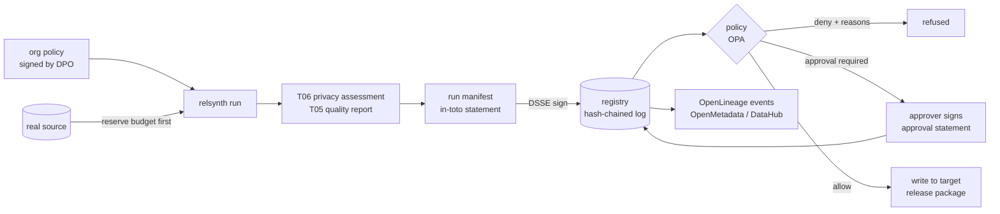

# Governance core and differential privacy for releases: design (T08)

- Status: design accepted by the user, 2026-10-27 (decisions in §17). Build follows in wave C, after T03; the DP engine itself is T07.
- Scope: run manifests, signing and tamper evidence, the registry, the policy engine, approvals, lineage and catalogs, and the organisation's privacy budget. The budget is the part of differential privacy that spans runs. It answers three questions: who sets ε, how spending is tracked across releases, and how a release outside the organisation is refused without DP.
- Not in scope: DP mechanisms, the accountant inside a run, and the DP-safe pipeline (all T07); the service, UI and identity provider (T09).
- Companion files: [ADR 0002](../adr/0002-policy-engine.md) (OPA vs Cedar); schemas in [schemas/](schemas/); examples in [examples/](examples/); Propositions 800–803 in `docs/proofs/sec_v25_governance.tex`; checks C800–C803 in `tests/science/test_governance_checks.py`.

## 1. What this must achieve

| T08 requirement | Where |
|---|---|
| Run manifest: source fingerprint (no data), spec and IR hash, versions, seeds, privacy settings and ε spent, quality and privacy reports, approver and decision | §6 |
| Signed and tamper-evident (hash chain) | §7, Prop. 803 |
| Registry of datasets, models, reports, approvals; storage behind an interface | §10 |
| Policy engine on OPA or Cedar, with an ADR and example policies | §8, ADR 0002 |
| Human approval that cannot be skipped for external releases | §9 |
| Organisation policy holds ε, δ, the privacy unit and the per-period budget; DP required outside the organisation; budget tracked per source across runs | §4, §5, Props. 800–802 |
| OpenLineage events; push to OpenMetadata and DataHub | §12 |
| CLI and API to list, inspect, approve, revoke | §13 |

| Acceptance criterion | How the build proves it |
|---|---|
| A tampered manifest or report is detected | `relsynth gov verify` on a registry with edited, deleted, inserted, reordered and truncated entries, and with a report whose bytes changed (C803 and an end-to-end test) |
| A policy blocks a failing dataset with a readable reason | End-to-end tests: DP missing for `partner`; budget exceeded; T06 `fail`; quality below the minimum; target not allowed. Each prints the reason sentence from §8 |
| Lineage of a run appears in a local Marquez or OpenMetadata | Integration test with Marquez in `docker-compose.test.yml`; run, then query Marquez's API for the job, its input and output datasets and the `relsynth_privacy` facet |

## 2. Principles

1. **No real data in governance artefacts.** A manifest, ledger entry or lineage event holds hashes, versions, settings and privacy figures. It never holds values, row counts or category levels. Exact row counts are a statistic of the people, so they belong in a DP release only as noisy counts.
2. **The budget belongs to the people, not to a table.** Every source that holds data about the same population draws on one budget (§5.1).
3. **Policy can tighten, never loosen.** Four invariants are enforced in code whatever the policy says (§8.3). A missing or broken policy refuses the release.
4. **relsynth ships no ε for external releases** (user decision, 2026-10-26). An external release is impossible until the organisation's privacy owner has written a budget into the policy.
5. **Everything is verifiable offline.** On-premises and air-gapped installs are the main target. Online services (Sigstore, transparency logs, catalogs) are optional add-ons.
6. **Standards, not inventions.** in-toto attestations in DSSE envelopes, RFC 8785 canonical JSON, Ed25519, OPA/Rego, OpenLineage, and NIST SP 800-226 for every DP statement.

## 3. How a run flows



Order matters in two places:

- Budget is **reserved before** the first read of real data (§5.4).
- The synthetic data is written to an external target only **after** an allow decision that cites valid approvals (§9). For internal targets the run can write first and be gated at publication, because the data does not leave the organisation.

## 4. The organisation policy

Format `relsynth.org-policy/1`: [schema](schemas/org-policy-1.schema.json), [example](examples/org-policy.yaml). The privacy owner (usually the DPO) writes it and signs it with their key. A new version is a new registry entry, and every manifest records the digest of the policy it was judged under.

It holds:

- **Domains.** A domain is a population of people (the privacy unit, which must equal the IR privacy unit of T02 for every source in it) and the list of source ids that hold their data. For each domain it also holds the adjacency (add/remove by default) and the budget: δ, the lifetime ε cap, an optional per-period cap, and the largest ε of one release.
- **Release contexts.** Whether the context is external, what the attacker is assumed to know, whether DP is required, the five T06 limits, the approval rule (which verdicts need approval, from which roles, and how many approvers), and the allowed targets. This is RFC-T06-03 item 1. The schema makes `external: true` imply `dp_required: true`, `attacker_knows: all` and approval even on `pass`.
- **The quality minimum** (T05 pass rate), **approval rules** (separation of duties, expiry) and **who may re-identify** salted person labels in privacy reports.
- **Optional organisation Rego modules.**

**No defaults for external budgets.** `relsynth gov init` writes a policy skeleton whose external contexts have no budget. Validation then fails with "the organisation must set ε and δ for domain …; see the guidance". The guidance (part of T07's deliverables) explains the following, citing NIST SP 800-226 §2.2:

- NIST gives no specific rule for choosing ε.
- One study it cites suggests that ε near 0.1 gives strong protection and that values below 1 are reasonable.
- Deployments use 1 < ε ≤ 20, and the risk above 1 should be evaluated, for example with the T06 attacks.
- δ above 10⁻⁵ is suspicious; δ ≤ 1/n² is a common choice.

The schema refuses δ > 10⁻⁵.

## 5. The privacy budget ledger (DP across releases)

### 5.1 Domains, not sources

The T08 prompt says to track the budget "per source". This design keys the budget on the **domain**: the people, across all sources that hold their data. Neighbouring datasets differ in one person's data everywhere at once (Ponomareva et al. 2023; NIST SP 800-226 §2.4). So a release from the warehouse and a release from the CRM extract compose for every customer who is in both. Keying by source would let two sources each spend the full budget on the same people.

- A source belongs to exactly one domain. The run manifest records the source id and domain.
- A run whose source is in no domain cannot run in DP mode. It can still run without DP for internal contexts.
- A schema with two populations of people, such as AdventureWorks customers and employees (T02 decision 3), has two domains. A run that reads both is charged to both, each with the guarantee for its own unit. Multi-unit DP is T07's design.
- Source matching uses `source.fingerprint.locator_hmac`, an HMAC of the connection locator without credentials, so the same database is recognised across runs without exposing its host name.

### 5.2 What the ledger stores and states (Prop. 800)

T07 reports one **charge** per mechanism, stating its kind and its guarantee with respect to the domain's unit and adjacency. A charge is either pure ε, ρ-zCDP, or approximate (ε, δ). The ledger converts every charge to δ-approximate ρ-zCDP and adds them up. It then states the cumulative guarantee as ε at the domain's δ, using the conversion of Canonne, Kamath and Steinke (2020). When every charge is pure, it uses basic composition instead if that gives a smaller ε.

Check C800 tests this against mechanisms whose exact privacy loss is known: compositions of Gaussian mechanisms and of randomised response.

- The ledger is never optimistic.
- It is never looser than the classic zCDP conversion.
- It is at most 1.6 times the exact ε for Gaussian mechanisms.

For scale, at δ = 10⁻⁸:

| ε | 0.5 | 1 | 2 | 4 | 8 |
|---|---|---|---|---|---|
| ρ | 0.0046 | 0.017 | 0.064 | 0.23 | 0.82 |

Policy caps are written in ε, which is what people understand. relsynth converts each cap to ρ at the domain's δ and compares in ρ, where composition is exact addition.

Within a run, T07 may use a tighter accountant, such as Rényi DP with subsampling. It then reports a valid zCDP upper bound for the run as its charge to the ledger. The ledger stays simple and conservative across runs.

### 5.3 Lifetime cap and period cap (Prop. 801)

A cap that resets every period protects a person only for that period. For example:

- Twelve monthly releases at ρ = 0.05 each are stated as ε = 1.76 per month, at δ = 10⁻⁸.
- The exact loss over the year for a person present all year is ε = 6.39, and the lifetime ledger states 6.74 (C801).

NIST SP 800-226 §2.4.2 makes the same point: ε = 1 per day can add up to ε = 365 over a year.

The design therefore has two caps:

- **Lifetime cap (mandatory).** It never resets, and it is the number every external DP statement quotes as the domain's cumulative guarantee.
- **Period cap (optional).** It is a throttle that spreads the lifetime budget over time, and it is labelled as such in every report.

If an organisation really wants a renewable budget, it must say so as a guarantee per period. That is a weaker promise (decision D1).

### 5.4 Reserve before reading (Prop. 802)

A DP run goes through four steps:

1. It **reserves** its planned budget in the ledger under a lock. The reservation is refused if it would exceed any cap.
2. It writes a **touch** record before its first read of real data.
3. At the end it **settles** with the accountant's figure, which is at most the reservation.
4. A reservation is **refunded** only if no touch record exists.

A crash after reading keeps the full reservation charged. Prop. 802 shows that the charged total then never falls below the true loss and never exceeds the cap, whatever the concurrency and crashes. C802 checks this with 40 concurrent runs over 20 trials. The proposition relies on T07 refusing any mechanism that would exceed the run's plan.

Other consequences:

- **Revoking a release never refunds budget.** Once data is out, the privacy loss has happened.
- **Failed policy checks do not refund either.** The data was read. This is a reason to run the cheap checks first: schema and policy-shape checks need no data.
- **Assessment and evaluation that read real data** (T06 attacks, T05 metrics) are not charged when their results stay inside the organisation. They are covered by the internal context. Any such result that goes into an external package must be computed under DP and charged (§11).

### 5.5 Runs without DP on the same people

Internal releases may run without DP under policy. A non-DP release of a domain is recorded in the ledger as an uncharged `nondp` entry. It does not change the numbers, but every DP statement of that domain then carries the note: "this guarantee does not cover other releases of the same data made without DP". NIST SP 800-226 §2.6 lists this as a hazard, because DP does not limit what other releases reveal. The policy can forbid non-DP runs on a domain entirely (decision D3).

### 5.6 Randomness and reproducibility

DP noise must be unpredictable. The manifest therefore records the seeds of non-private stages only (`seeds.generator`, `seeds.assessment_split`). DP noise comes from the operating system's CSPRNG through OpenDP and is never seeded or recorded. If a manifest recorded the noise seed, anyone holding the manifest and the release could subtract the noise.

As a result, **a DP run is not bit-reproducible**. Reproducibility comes from the signed outputs in the registry, not from re-running. This changes the 1.0 promise that a seed reproduces a run, but only for DP runs. T07 should state it in its user guide.

### 5.7 The DP statement of a release

Each DP release carries a `dp_statement` (schema `relsynth.dp-statement/1`, to be finalised with T07). It is the only privacy document that leaves the organisation. Following NIST SP 800-226 (§2.3–§2.6, §3.1), it states:

- the unit of privacy and the adjacency;
- ε and δ of this release at the domain's δ, plus the native figures (ρ, and δ₀ when present);
- the domain's cumulative ε after this release, and the lifetime cap;
- the accounting method and the conversion used;
- the mechanisms by stage, and which inputs were public facts (T07's DP-safe pipeline);
- which keys and rules hold exactly as post-processing;
- the DP library and version;
- the hazards that apply: non-DP releases of the same people (§5.5), the period cap if any (§5.3), and that an average-case audit does not bound outliers (§2.7).

T06 prints the Kairouz bound (Prop. 602) for both the release ε and the cumulative ε. An attacker who holds every release of a domain faces the cumulative figure (RFC-T06-03 item 2, §14).

## 6. Run manifest

Format: an [in-toto Statement v1](https://github.com/in-toto/attestation/blob/main/spec/v1/statement.md) with `predicateType` `https://github.com/nick-developer/relsynth/run-manifest/1`. See the [schema](schemas/run-manifest-1.schema.json) and the [example](examples/run-manifest.example.json). The subjects are the synthetic tables with the sha256 of their canonical export, so a recipient can check the files they got against the signed manifest. The predicate holds:

- `run`: a ULID, times, the operator (name and key fingerprint) and the command line with credentials removed.
- `source`: the source id, the domain and a fingerprint. The fingerprint is an HMAC of the locator, a hash of the schema structure and an optional snapshot id. It holds no data.
- `spec`: digests of the spec and of the IR, the IR version, and `public_facts_only`, set by T07 when a DP run used only public facts or charged statistics.
- `software`: the versions of relsynth, the plug-ins (with digests, for T03), the accountant, Python and the platform.
- `seeds`: non-private stages only (§5.6).
- `privacy`: the mode, unit, adjacency, charges by stage, the run total, the stated (ε, δ), and the ledger entry with the domain's cumulative figures. Numbers are decimal strings, so that hashing is exact.
- `reports`: the kind, schema and digest of each report, and `external_safe`.
- `verdicts`: the T06 verdict per context.
- `policy`: the policy digest and version, the engine version, and the decision per context with its reasons.
- `release`: the intended context and target.
- `chain.prev`: the registry head when the manifest was made.

Approvals, rejections and revocations are separate statements (`.../approval/1`, `.../revocation/1`) whose subject is the manifest's digest. A manifest is never edited after it is signed. Everything that happens later is a new statement that refers to it.

## 7. Signing and tamper evidence (Prop. 803)

- **Envelopes.** Every statement is signed in a [DSSE v1](https://github.com/in-toto/attestation/blob/main/spec/v1/envelope.md) envelope.
- **Default keys.** Local Ed25519 keys (RFC 8032), one per person or service, created by `relsynth gov keys new`. Private keys stay in the user's key store or a KMS/HSM in T09. Public keys and roles are in `registry/keys/trusted.json`, which is itself a signed statement by the privacy owner.
- **Optional Sigstore.** On public clouds, Sigstore keyless signing (OIDC identity, Fulcio certificate, Rekor log) can replace local keys. cosign and sigstore-python verify in-toto attestations in DSSE. It is optional, because it needs network access to Fulcio and Rekor, or a private Sigstore deployment.
- **Hash chain.** The registry log is append-only JSON Lines. Each entry is `h_i = SHA-256(h_{i-1} ‖ JCS(e_i))`, with canonical JSON per RFC 8785.
- **Checkpoints.** After each release, and on demand, the head `(seq, h)` is signed as a checkpoint.

Prop. 803: given an authentic checkpoint, any edit, deletion, insertion, reordering or truncation before it is detected, unless SHA-256 is broken. C803 found all 400 random tamperings and rejected forged checkpoints.

**Limitation.** An operator who controls the store and a signing key can rewrite history and sign a new checkpoint. Tamper evidence towards third parties therefore needs the checkpoint to live somewhere the operator cannot change:

- in the release package the recipient keeps;
- with the approver, who countersigns it;
- or, optionally, in a transparency log (Rekor, or any RFC 6962-style witness).

`relsynth gov verify` checks the chain, every signature, every report digest against its stored bytes, and the subjects against the files. It exits non-zero with the first failing entry.

## 8. Policy engine

### 8.1 Choice

OPA with Rego; see [ADR 0002](../adr/0002-policy-engine.md). The release rules compare real numbers (δ = 10⁻⁹, limits like 0.05) and must return readable reasons. Cedar's 4-digit decimals and its allow/deny model fit worse. Cedar remains a candidate for T09's access control.

### 8.2 Input and output

`data.relsynth.release.decision` takes:

```json
{
  "policy": "<the org policy>",
  "manifest": "<manifest predicate>",
  "manifest_digest": "<sha256>",
  "ledger": {"domain": "customers", "delta": 1e-9, "run_rho": 0.05,
             "domain_rho_after": 0.08, "lifetime_rho_cap": 0.435, "lifetime_epsilon_cap": 6.0,
             "period_rho_after": 0.08, "period_rho_cap": 0.121,
             "per_release_rho_cap": 0.056, "per_release_epsilon_cap": 2.0},
  "privacy_checks": "<T06 checks of the context>",
  "quality": {"pass_rate": 0.97},
  "approvals": ["<verified approval statements>"],
  "request": {"action": "release", "context": "partner", "target": "partner-sftp",
              "package": ["<digests of files to ship>"]}
}
```

It returns `{"allow": bool, "approval_required": bool, "reasons": [...]}`. Python verifies the signatures of approvals before they enter the input, and converts ε caps to ρ (Rego only compares). The draft rules are in [examples/policies/release.rego](examples/policies/release.rego). Reasons read like:

- "context "partner" is outside the organisation: differential privacy is required, and this run has none"
- "domain "customers" would reach rho 0.47, above its lifetime cap 0.435 (epsilon 6 at delta 1e-09)"
- "the privacy verdict for context "public" is "fail"; it cannot be released or approved"
- "context "public" needs 2 approval(s) from ["dpo"]; 1 valid"
- "the privacy report was computed on real data without DP and cannot leave the organisation"

### 8.3 Invariants in code

These hold even if the policy is absent, broken or permissive:

1. An external context requires `privacy.mode = dp`, with a unit equal to the domain's unit.
2. An external context requires at least one valid approval by someone other than the operator.
3. A `fail` or `blocked` verdict cannot be released or approved.
4. No reservation may exceed the domain's lifetime cap.

An OPA error, a missing binary or an invalid policy means **deny**.

## 9. Approval flow

States of a release request:

```
draft ── assessed ── pending_approval ── approved ── released
              │              │                         │
              └── denied     └── rejected              └── revoked
```

- **Who may approve.** A signer whose key is in `trusted.json` with one of the context's `approver_roles`. Separation of duties is on by default, so the operator cannot approve their own run. A quorum can be set per context (for example two for `public`). Approvals expire if unused (`approvals.expires_after`).
- **What an approval covers.** One manifest digest and one context. An approval names the verdict and the DP figures it saw. If anything changes, there is a new manifest, so a new approval is needed.
- **When approval is needed.** Every external release. Internal releases need it on the verdicts the policy lists (default: `review`; RFC-T06-03 item 3, T06 decision 2). `fail` and `blocked` cannot be approved.

**Why it cannot be skipped.** Writers to targets of an external context accept only a *release token*. The token is a short signed statement made by `relsynth gov release` after an allow decision, and it binds the manifest digest, the context, the target and the approvals. The target writer verifies the token before it opens a connection. The release package carries the manifest, the approvals and a checkpoint, so the recipient can verify with `relsynth gov verify` that a named approver approved exactly these files.

**Honest limit.** relsynth is open source, so an operator can patch it or copy files by hand. What the design guarantees is that relsynth itself never writes an external release without an approval, and that the recipient can see whether a valid approval exists. The organisation's controls (T09 service accounts, network rules) stop out-of-band copies.

## 10. Registry

The interface is a Python `Protocol`:

- `put_blob(bytes) -> digest`, `get_blob(digest)`
- `append(statement_envelope) -> seq`, `head()`, `checkpoint(signer)`
- `entries(filter)`, `get(id)`
- ledger operations `reserve`, `touch`, `settle`, `release_reservation`, under one lock with `append`
- a secrets area (the HMAC key for locators, and the label salts of privacy reports)

**First backend: a local folder.**

```
registry/
  objects/sha256/ab/cdef…   content-addressed manifests, reports, envelopes
  log.jsonl                 hash-chained entries (Prop. 803)
  checkpoints/<seq>.dsse    signed heads
  keys/trusted.dsse         public keys and roles, signed by the privacy owner
  secrets/                  HMAC key, label salts (0600, or a KMS reference)
  lock                      advisory file lock for append and ledger operations
```

The ledger is a view over `ledger.*` entries of the same log, so the budget history is covered by the chain too. A database backend (PostgreSQL, with SERIALIZABLE transactions for the ledger) comes with T09. Retention: manifests and the ledger are kept for the life of the domain. Synthetic outputs follow the organisation's retention, and deleting them leaves their digests in the log.

## 11. What may leave the organisation

An external release package holds:

- the synthetic data;
- the signed manifest;
- the approvals and the release token;
- a checkpoint;
- the DP statement;
- optionally, quality metrics computed under DP and charged.

It does **not** hold the T06 privacy report. That report is computed on real data and lists the people most at risk, so it is an internal document for the DPO. It also does not hold a T05 report computed on real data without DP, or a spec with data-derived values (category levels, minima and maxima) unless T07 marked them as public facts.

The manifest's `external_safe` flag and the policy rule in §8.2 enforce this. It is the "other releases of the same data" hazard of NIST SP 800-226 §2.6 applied to our own reports.

## 12. Lineage and catalogs

- Each run emits [OpenLineage](https://openlineage.io) `START` and `COMPLETE` (or `FAIL`) RunEvents. The job is `relsynth.run` in namespace `relsynth://<registry id>`.
- **Inputs** are the source datasets, with the schema facets that T02's `ir/openlineage.py` already builds (structure only).
- **Outputs** are the synthetic datasets with their schema and column-lineage facets.
- **Custom run facets:**
  - `relsynth_manifest`: digest, run id, registry URI.
  - `relsynth_privacy`: mode, unit, release ε and δ, domain cumulative ε, verdict per context.
  - `relsynth_approval`: state and approvers' names, added on approval.
- Each facet carries `_producer` and `_schemaURL`, as OpenLineage requires, with JSON Schemas published under `docs/governance/schemas/`.
- Approval and revocation emit further events on the same run.
- **Transport** is an HTTP client to any OpenLineage endpoint: Marquez (the reference backend, used for the acceptance test), DataHub's OpenLineage endpoint, and OpenMetadata's OpenLineage connector. Where a catalog needs more than lineage (tags such as `synthetic`, `dp`, `approved-for:partner`, or deprecation on revocation), a small push client uses its REST API.
- Guessing: the exact DataHub and OpenMetadata endpoints and versions will be confirmed against live instances in the build.
- Events carry no data and no row counts. Output row counts are synthetic and may be included.

## 13. CLI and API

```
relsynth gov init REGISTRY                  create a registry and a policy skeleton (no external budgets)
relsynth gov policy check POLICY            validate, show domains, caps in epsilon and rho
relsynth gov policy sign POLICY             privacy owner signs a new policy version
relsynth gov keys new|list|trust            Ed25519 keys and roles
relsynth gov ls [--domain D] [--state S]    runs, releases and their states
relsynth gov show RUN                       manifest, verdicts, DP figures, approvals, decision reasons
relsynth gov budget [DOMAIN]                ledger: spent, reserved, caps, history, non-DP releases
relsynth gov approve RUN --context C        sign an approval (or --reject --reason …)
relsynth gov release RUN --context C        evaluate policy, issue release token, write to target
relsynth gov revoke RUN --reason …          revocation statement, catalog deprecation (no budget refund)
relsynth gov verify [REGISTRY|PACKAGE]      chain, signatures, digests, subjects
relsynth gov lineage emit RUN --url …       (re)send OpenLineage events
```

`relsynth run` gains `--registry` and `--context`. With a registry configured, it reserves budget, writes the manifest and evaluates policy. The API mirrors these in `relsynth.governance`: `Registry`, `Ledger`, `Policy`, `approve`, `release`, `verify`.

## 14. Interfaces with other threads, and the answer to RFC-T06-03

| Thread | Interface |
|---|---|
| T02 | The domain's unit must equal `EstatePrivacy.unit.entity` of each source's IR; the IR digest goes in the manifest; T02's OpenLineage export provides the dataset facets |
| T05 | Quality report digest and pass rate go into the manifest and policy input; the report is `external_safe` only when computed under DP |
| T06 | Contexts and limits move to the org policy; verdicts go in the manifest; changes below |
| T07 | Reports charges per mechanism (kind and figures, w.r.t. the domain's unit); calls `reserve` before reading and `settle` after; refuses mechanisms beyond the reservation; sets `public_facts_only`; uses a CSPRNG for noise; co-owns `relsynth.dp-statement/1` |
| T09 | Replaces key fingerprints with identities (OIDC), adds a database registry backend, KMS keys and RBAC (perhaps Cedar) |
| T17 | Uses manifests, ledger and approvals as evidence; maps §5.7 to NIST SP 800-226 and §9 to EDPB accountability |

**RFC-T06-03 is accepted, with three changes** (the full reply is in `/mnt/project-files/roadmap/rfcs/RFC-T06-03-policy-and-manifest.md`):

1. **Contexts and limits in the policy.** Accepted as proposed. `dp_required` must be true for external contexts, and the schema refuses anything else. T06 reads `contexts` from the org policy when `--policy` is given, else from `privacy.yaml`, else its defaults.
2. **ε, δ and unit in the policy.** Accepted, as a *budget* per domain rather than one fixed ε: a lifetime cap, a per-release cap and an optional period cap (§5). T07 fills `release.dp` from the ledger with this release's (ε, δ) and the domain's cumulative ε. T06 prints the Kairouz bound for both.
3. **Manifest contents and approvals.** Accepted. The manifest records the privacy report's digest and schema, the verdict per context, the split seed and the relsynth version. `review` needs a named approval in the contexts where the policy says so (default: all), and `fail` and `blocked` cannot be approved. *Change:* the privacy report is never part of an external package (§11).
4. **Re-identifying salted labels.** *Change:* the salt must not be the split seed, because the manifest records the split seed, and anyone holding the manifest and the real data could then reverse the labels. T06 should draw a separate 256-bit salt and store it in the registry's secrets area. The report then carries only a salt id. The policy's `reidentification.allowed_roles` says who may run `relsynth privacy reveal`, and each use is logged.

## 15. Build plan (wave C)

Each item is one PR. Items 1–4 need only T02 (merged in wave A); item 5 needs T07's charge interface.

1. `relsynth.governance` core: canonical JSON (RFC 8785), DSSE and Ed25519 signing, local registry, hash chain, checkpoints, `gov init/keys/ls/show/verify`. Checks C803 and tamper end-to-end.
2. Org policy: schema, loader, `gov policy check/sign`, ε↔ρ conversion; ledger with reservations (C800–C802 moved onto the real code).
3. Policy engine: pinned OPA, `release.rego` with `opa test`, invariants in code, readable reasons; end-to-end blocking tests.
4. Approvals and release tokens; target writers check tokens for external contexts; `gov approve/release/revoke`.
5. Integration with T06 (policy reader, salt change) and T07 (charges, reserve/settle, DP statement).
6. OpenLineage emitter, Marquez integration test, OpenMetadata and DataHub push.

No engine code changes, so the regression suites (science C00–C78 and the four real databases) should give identical outputs. Each PR will show that.

## 16. Risks and limitations

- **A false DP claim is the worst failure.** The ledger is only as good as the charges T07 reports, and as T07's guarantee that nothing reads real data unaccounted. The ledger is conservative (Props. 800 and 802), but it cannot see an uncharged read. T07's audit with T06 attacks at several ε is the empirical cross-check.
- **Source matching by locator** misses a copy of the same people in a source the policy does not list. The policy owner must list all sources of a domain. `gov budget` warns when a run's schema fingerprint matches a known domain's but its locator does not.
- **The legal status is not settled.** The EDPB guidelines 02/2026 are a draft (consultation to 30 October 2026). DP with a lifetime cap is strong technical evidence, but whether a release is anonymous is still a legal judgement in context. T17 tracks the final text.
- **Open source** means enforcement is by relsynth's own code paths plus verifiability, not by preventing tampering with the software (§9).
- **Not verified yet:** the Rego draft has not been run under OPA here (the binary could not be installed in this environment); citation section numbers for approximate zCDP in Bun and Steinke (2016) should be confirmed when the proofs PDF is rebuilt.

## 17. Decisions taken by the user (2026-10-27)

The user accepted all five recommendations:

- **D1.** The per-period cap is only a throttle under a mandatory lifetime cap. There is no renewable budget.
- **D2.** Budgets are kept per privacy domain (the people across all sources), not per source.
- **D3.** Non-DP runs on a DP domain are recorded in the ledger and flagged in every DP statement of that domain. They are not forbidden by default.
- **D4.** An internal `review` verdict needs a named approval by default.
- **D5.** OPA/Rego is the release policy engine (ADR 0002 accepted). Cedar stays open for T09 access control.

## Sources

- NIST SP 800-226, *Guidelines for Evaluating Differential Privacy Guarantees* (Near, Darais, Lefkovitz, Howarth; March 2025), §2.2 ε, §2.3 δ, §2.4 unit of privacy, §2.6 other releases, §2.7 auditing, §3.1 implementation. https://doi.org/10.6028/NIST.SP.800-226
- EDPB Guidelines 02/2026 on anonymisation, version for public consultation, adopted 7 July 2026; consultation to 30 October 2026: three criteria (no record isolation, no linkage, no inference), contextual and simplified assessments, documentation of evidence, periodic reassessment. Summary: https://privacymatters.dlapiper.com/2026/08/eu-edpb-publishes-draft-guidelines-on-anonymisation/
- CJEU, C-413/23 P, *EDPS v SRB*, 4 September 2025 (identifiability from the recipient's perspective).
- M. Bun, T. Steinke, Concentrated differential privacy, TCC 2016.
- C. Canonne, G. Kamath, T. Steinke, The discrete Gaussian for differential privacy, NeurIPS 2020.
- I. Mironov, Rényi differential privacy, IEEE CSF 2017.
- B. Balle, Y.-X. Wang, Improving the Gaussian mechanism for differential privacy, ICML 2018.
- J. Dong, A. Roth, W. Su, Gaussian differential privacy, JRSS-B 2022.
- P. Kairouz, S. Oh, P. Viswanath, The composition theorem for differential privacy, ICML 2015.
- C. Dwork, A. Roth, The algorithmic foundations of differential privacy, 2014.
- N. Ponomareva et al., How to DP-fy ML, JAIR 77, 2023.
- in-toto Attestation Framework, Statement v1 and DSSE envelope v1: https://github.com/in-toto/attestation
- RFC 8785 (JCS), RFC 8032 (EdDSA), RFC 6962 (Certificate Transparency).
- Open Policy Agent: https://www.openpolicyagent.org; Cedar: https://www.cedarpolicy.com, https://docs.cedarpolicy.com/policies/syntax-datatypes.html; Disselkoen et al., How we built Cedar, 2024, https://arxiv.org/abs/2407.01688.
- OpenLineage: https://openlineage.io; Marquez: https://marquezproject.ai; OpenMetadata; DataHub; W3C PROV-O (the manifest's fields map onto `prov:Activity` (the run), `prov:Entity` (source fingerprint, outputs, reports) and `prov:Agent` (operator, approver)).
