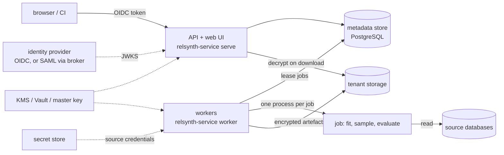

# relsynth service

The service runs relsynth for a whole organisation: people sign in with the organisation's identity provider, register connections to source databases, review the spec that introspection drafts, run syntheses, compare reports, and approve the synthetic data before anyone downloads it. Everything is audited, and each tenant's data and metadata are isolated from every other tenant's.

It is built for on-premises installs first (air-gapped bundle, docker compose, Helm for Kubernetes and OpenShift) and also runs in an organisation's own AWS, Azure or GCP account. There is no SaaS.

| Document | What it covers |
|---|---|
| [deployment.md](deployment.md) | docker compose, Helm (Kubernetes, OpenShift), air-gapped bundle, AWS / Azure / GCP accounts, upgrades |
| [identity.md](identity.md) | OIDC and SAML single sign-on, roles and permissions, ABAC, service accounts |
| [tenancy.md](tenancy.md) | how tenants are isolated: store, files, keys, workers, network; what is persisted |
| [operations.md](operations.md) | logs, metrics, traces, audit log, health checks, backup and restore, high availability, runbook |
| [security/threat-model.md](security/threat-model.md) | STRIDE threat model of the service |
| [security/asvs-l2.md](security/asvs-l2.md) | OWASP ASVS 4.0.3 level 2 checklist with evidence |
| [security/pentest-plan.md](security/pentest-plan.md) | penetration test plan |
| [security/control-mapping.md](security/control-mapping.md) | SOC 2, ISO/IEC 27001:2022 and NIST SP 800-53 rev. 5 control mapping |
| [openapi.json](openapi.json) | the REST API (also served at `/api/v1/openapi.json`, browsable at `/api/v1/docs`) |

## Architecture



- The **API** is stateless; run two or more replicas behind the ingress.
- The **metadata store** holds tenants, projects, connections (locations and secret references, never passwords), spec versions, runs, approvals, service accounts and the hash-chained audit log.
- **Workers** lease jobs from the store, run each attempt in a separate process with its own limits, encrypt the outputs into the tenant's storage, and delete every plaintext file. A run whose worker dies is resumed by another worker.
- **Source rows are never persisted.** Real data exists only in the memory of the job process. What is kept is the synthetic data, the reports (aggregate statistics) and the spec. A unit test checks the store, the artefacts and the disk for the source's values after a run.

## Quick start (single machine, for evaluation)

```bash
pip install "relsynth[service,postgres]"
export RELSYNTH_SVC_AUTH_MODE=dev RELSYNTH_SVC_ALLOW_DEV_AUTH=true    # header sign-in: evaluation only
export RELSYNTH_SVC_FILE_ROOTS=$PWD/files                             # CSV/SQLite sources below files/<tenant>/
relsynth-service serve --port 8080 &
relsynth-service worker &
open http://localhost:8080/ui/          # sign in as "me; acme:engineer,acme:privacy_officer"
```

For a real install with single sign-on use [deployment.md](deployment.md); `deploy/compose` starts PostgreSQL, Keycloak, the API and two workers in one command.

## The flow

1. **Connect.** A data owner or engineer registers a connection: a relsynth source section without credentials plus `secret_ref`, a reference to the password in the organisation's secret store (`vault:`, `file:`, `env:`, `aws-sm:`, `azure-kv:`, `gcp-sm:`).
2. **Draft.** `POST /connections/{id}/introspect` queues a job that drafts a spec. The draft and its `review:` questions become spec version 1.
3. **Review.** The UI lists the review questions as a checklist; the Run button stays disabled until each one is ticked and the spec has no errors. Edits are saved as new versions; nothing is overwritten.
4. **Run.** `POST /runs` queues a synthesis; the worker fits, samples, evaluates (scorecard and quality report 2.0) and stores the outputs encrypted.
5. **Compare.** `GET /compare?a=&b=` lists the checks whose verdict or value changed between two runs.
6. **Approve.** A privacy officer or data owner who did not start the run approves (or rejects, with a reason). Revocation closes the release again.
7. **Download.** A consumer downloads the approved tables as a zip with a manifest of SHA-256 digests.

Runs for an `external` context (data leaving the organisation) are refused until the DP engine (T07) and the governance build (T08) are installed, because the organisation decided that every external release needs differential privacy.

## Settings

Every setting is an environment variable `RELSYNTH_SVC_<NAME>`, or a key of the YAML file named by `RELSYNTH_SVC_CONFIG`. The defaults are in `src/relsynth/service/config.py`. The service refuses to start with unsafe combinations (for example dev sign-in without `ALLOW_DEV_AUTH`).

| Setting | Default | Meaning |
|---|---|---|
| `DB_URL` | `sqlite:///./relsynth-service/service.db` | Metadata store. PostgreSQL for anything beyond one node. |
| `DATA_DIR` | `./relsynth-service/data` | Encrypted artefacts (`tenants/<id>/runs/...`) and job work folders (`work/`). |
| `AUTH_MODE` | `oidc` | `oidc`, or `dev` (header sign-in, needs `ALLOW_DEV_AUTH=true`). |
| `OIDC_ISSUER`, `OIDC_AUDIENCE` | –, `relsynth` | Token issuer and audience. |
| `OIDC_JWKS_URL` / `OIDC_JWKS_FILE` | discovery | Where the signing keys come from; a file for air-gapped installs. |
| `ROLES_CLAIM` | `relsynth_roles` | Claim (dotted path allowed) with `"<tenant>:<role>"` values. |
| `TENANT_CLAIM` | – | Claim naming one tenant, for IdPs that emit bare role names. |
| `ABAC` | `false` | Enforce connection classification against the user's `clearance` attribute. |
| `KMS`, `KMS_KEY_ID`, `MASTER_KEY_REF` | `local`, –, `file:./relsynth-service/master.key` | Key-encryption keys: local master key, Vault transit, AWS KMS, Azure Key Vault, GCP KMS. |
| `FILE_ROOTS` | – | Roots for file sources; a tenant sees only `<root>/<tenant>`. Empty disables file sources. |
| `ALLOWED_KINDS`, `ALLOWED_HOSTS` | all kinds, any host | Source kinds and database host globs a connection may use. |
| `APPROVAL_INTERNAL`, `APPROVAL_QUORUM`, `SEPARATION_OF_DUTIES` | `true`, `1`, `true` | Release rules. |
| `LEASE_S`, `HEARTBEAT_S`, `MAX_ATTEMPTS` | 60, 10, 3 | Job leases and retries. |
| `JOB_TIMEOUT_S`, `JOB_MEMORY_MB`, `JOB_CPU_S` | 6 h, 0, 0 | Per-attempt limits (0 = none). |
| `WORKER_CONCURRENCY`, `WORKER_TENANTS`, `WORKER_EXCLUDE_TENANTS` | 1, –, – | Jobs per worker process; per-tenant worker pools. |
| `OTEL`, `LOG_JSON` | `false`, `true` | OpenTelemetry tracing; JSON logs. |
| `MAX_BODY_MB` | 16 | Largest request body. |

## Command line

```text
relsynth-service serve [--host --port --workers --proxy-headers]
relsynth-service worker [--once]
relsynth-service migrate | check
relsynth-service tenant add ID NAME | tenant list
relsynth-service audit verify TENANT | audit export TENANT
relsynth-service openapi [--out FILE]
```
