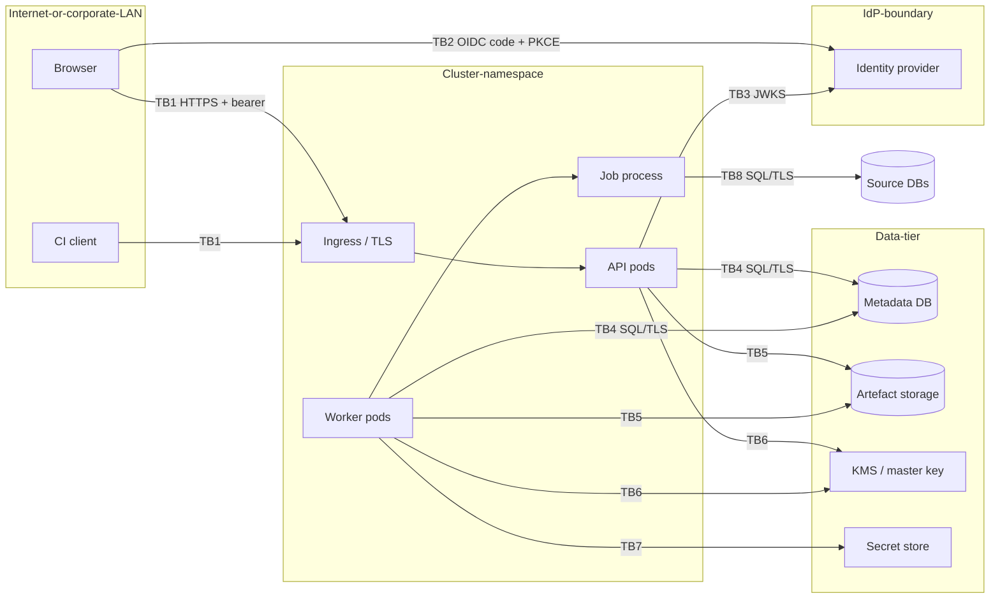

# Threat model (STRIDE)

Scope: the relsynth service as deployed by [deployment.md](../deployment.md): browser and CI clients, the API, workers and job processes, the metadata database, artefact storage, the key service, the secret store, the identity provider and the source databases. Method: data-flow diagram, then STRIDE per element (Shostack 2014; Microsoft SDL). This updates the library-level model in `docs/security.md` for the service. Review it at every release that changes an interface or trust boundary.

## Assets

| Asset | Why it matters |
|---|---|
| A1 Source data (rows of real people) | personal data; the reason the product exists is to avoid exposing it |
| A2 Source credentials | access to production databases |
| A3 Synthetic data before approval | may leak if the model memorised (judged by the privacy officer) |
| A4 Reports (scorecard, privacy items) | aggregate statistics of real data; privacy items name the records most at risk |
| A5 Master key / KEKs | decrypt every artefact |
| A6 Audit log | accountability; evidence for regulators |
| A7 Specs | describe the source schema and business rules (confidential design information) |
| A8 Tokens (user, service account) | act as a user |

## Data flows and trust boundaries

## Threats and mitigations

| # | Element | STRIDE | Threat | Mitigation | Evidence | Residual |
|---|---|---|---|---|---|---|
| T1 | API (TB1) | S | Forged or altered JWT | Signature via JWKS, asymmetric allow-list, `iss/aud/exp/nbf` | `test_bad_claims_are_refused`, `test_tampered_token_is_refused` | IdP compromise is out of scope |
| T2 | API | S | `alg: none` or HS256 with the public key | Refused, cannot be configured | `test_alg_none_and_hmac_confusion_are_refused`, `test_hmac_algorithms_cannot_be_configured` | – |
| T3 | API | S | Dev header sign-in left on in production | Needs two settings; chart never sets them; startup refuses dev mode alone | `Settings.check`, `test_missing_token_and_dev_header_without_dev_mode` | operator misconfiguration of compose |
| T4 | API | S | Stolen service-account token | 256-bit tokens, hashed at rest, revocable, audited, cannot hold `tenant_admin` | `test_service_account_token_lifecycle` | token in CI logs: CI secret masking |
| T5 | API | E | Tenant A user reads tenant B's objects by id (IDOR) | Tenant path checked against token roles; store filters by tenant; 404 for foreign ids | `test_tenant_isolation_on_every_route` (19 routes), e2e on compose and Kubernetes | – |
| T6 | API | E | Role escalation (engineer approves, consumer runs) | Permission table per route; separation of duties on approvals | `test_roles_and_refusals`, `test_full_flow_with_approval_and_download` | – |
| T7 | API | E | Approval skipped: download before approval | Download and data artefacts gated by the release decision | `test_full_flow...` (409 before approval, after revocation) | out-of-band copies by storage admins (encrypted) |
| T8 | API | T | Path traversal or symlink to read other tenants' files or host files | Path resolved and checked against `<root>/<tenant>`; credential keys refused | `test_source_policy` | – |
| T9 | Worker → sources | I/E | SSRF: connection points at cloud metadata or internal services | Host allow-list, NetworkPolicy egress, URL with password refused | `test_source_policy` (169.254.169.254) | allow-list not set by default: set it in production |
| T10 | Job process | I | Source secret leaks to other jobs or logs | Secret only in the job process environment; clean env; never logged; stderr discarded | `worker.ENV_KEEP`, code review | a malicious source driver |
| T11 | Job process | I | Real rows persisted (temp files, tracebacks, bundles) | Work folder deleted per attempt (emptyDir in k8s); message-only errors; no bundle kept | `test_no_source_row_is_persisted` | swap or core dumps on the node: disable on worker nodes |
| T12 | Storage | I | Volume or backup read by an operator or attacker | AES-256-GCM per artefact; per-tenant KEK; key outside the volume | `test_roundtrip...`, `test_other_tenant_cannot_read_or_unwrap` | master key theft: use a KMS/HSM |
| T13 | Storage | T | Ciphertext altered, truncated, chunks reordered or swapped across tenants | STREAM chunking with counter, final flag, tenant and artefact id in AAD | `test_tampering_is_detected` (4 attacks) | – |
| T14 | Metadata DB | T/R | Audit entries edited or deleted to hide an action | Per-tenant SHA-256 hash chain; verify endpoint; head exported to WORM | `test_audit_chain_verifies_and_detects_tampering`, `..._deletion_and_reordering` | tail truncation without exported head (T08 checkpoints) |
| T15 | Metadata DB | I | DB dump reveals secrets | Only secret references and token hashes stored | `test_no_source_row_is_persisted` (dump search), code review | spec bodies reveal schema (A7): encrypt DB volume |
| T16 | API | R | User denies having approved or downloaded | Audit entry per action with subject, time, request id; chain | e2e audit check | IdP account sharing |
| T17 | API | D | Huge bodies, slow requests, job floods | 16 MB body limit; per-job limits; queue; ingress rate limits | `test_security_headers_and_health` (413) | per-tenant quotas not built (open item) |
| T18 | Workers | D | A tenant's heavy jobs starve others | Per-tenant worker pools and resource limits | chart `tenants[]` | shared pool has no fair-share scheduler |
| T19 | Browser | T/I | XSS via spec names, review text, errors | textContent only; CSP `script-src 'self'`; no inline script | `app.js`, headers test | – |
| T20 | Browser | S | Clickjacking, token theft via referrer | `frame-ancestors 'none'`, `X-Frame-Options: DENY`, `Referrer-Policy: no-referrer`; token in sessionStorage per tab | headers test | sessionStorage readable by an XSS (none known) |
| T21 | Supply chain | T | Malicious dependency or image | Pinned CI actions, SBOM, Sigstore, pip-audit, licence check (T01); offline image build from checked wheels | CI | – |
| T22 | Release | I | External release without DP | `external` context refused until T07/T08 present | `test_roles_and_refusals` | – |
| T23 | IdP (TB3) | D | IdP down | JWKS cached; tokens verified locally until expiry | `_JWKS` cache | new sign-ins fail |

No threat rated high is open. Open medium items: per-tenant quotas and fair-share scheduling (T17, T18), signed audit checkpoints (T14, from T08), and the third-party penetration test ([pentest-plan.md](pentest-plan.md)).
