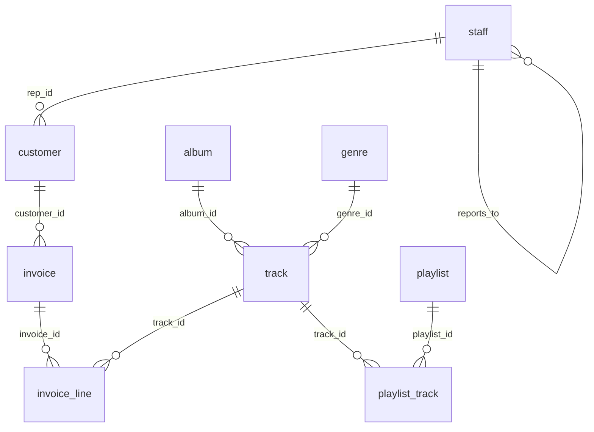

# User guide

This guide takes one database from first contact to a synthetic copy you can share, using the commands a business user or a CI job would run. Every output shown is real: it comes from running relsynth 1.0.0 on the example database shipped in [examples/quickstart/](../examples/quickstart/).

- [The example database](#the-example-database)
- [Step 1: draft a specification](#step-1-draft-a-specification)
- [Step 2: review the specification](#step-2-review-the-specification)
- [Step 3: check and plan](#step-3-check-and-plan)
- [Step 4: generate, write and score](#step-4-generate-write-and-score)
- [Step 5: read the scorecard](#step-5-read-the-scorecard)
- [Step 6: ask the doctor](#step-6-ask-the-doctor)
- [Step 7: check the model itself](#step-7-check-the-model-itself)
- [Step 8: share the model instead of the data](#step-8-share-the-model-instead-of-the-data)
- [Changing size, number of copies and stability](#changing-size-number-of-copies-and-stability)
- [Working with your own database](#working-with-your-own-database)
- [The same workflow in Python](#the-same-workflow-in-python)
- [Common questions](#common-questions)

## The example database

`examples/quickstart/shop.db` is a small SQLite music shop with 9 tables and 6,680 rows. It was generated from a known model, so you can run every step in a few seconds.

| Table | Rows | What it holds |
|---|---|---|
| staff | 8 | Sales staff, with a manager hierarchy (`reports_to`) |
| customer | 200 | Customers with city, state, country, tier and their sales rep |
| invoice | 1,000 | Invoices, with a billing country and a total |
| invoice_line | 4,032 | Lines: track, unit price, quantity |
| track | 900 | Tracks with album, genre, length, price and composer |
| album, genre, playlist | 60, 30, 12 | Reference lists |
| playlist_track | 438 | Which tracks are on which playlist |

```bash
cd examples/quickstart
```

## Step 1: draft a specification

```bash
relsynth introspect --source sqlite:shop.db --out spec.yaml
```

```
wrote spec.yaml: 9 tables, 9 relationships
```

`introspect` reads the catalog (declared keys and constraints) and a random sample of rows from each table (`--sample-rows`, 20,000 by default). From these it identifies:

- **Keys and links**: declared ones, and undeclared ones it finds in the data (values contained in another table's key, and names that match).
- **Table roles**: entities (customers, tracks), facts (invoice lines), reference lists copied as they are (genres), views and calendars.
- **Rules**: lookups (`invoice_line.unit_price` is the track's price), aggregates (`invoice.total` is the sum of its lines), derived columns, running balances, functional dependencies (a city determines its state and country).
- **Column types**: categorical, numeric, date, identifier, free text, personal data.

Each finding is kept only when it is unlikely by chance: the [proofs](proofs/relsynth-proofs.pdf) give the tests, for example the propositions "Inclusion by chance" for links and "Chance of a forest" for hierarchies.

## Step 2: review the specification

The draft is a plain YAML file. Its last section, `review:`, lists every decision that only you can confirm. For the shop it reads:

```yaml
review:
- 'album: 60 rows of reference data, copied as-is (set mode: synthesize if it holds confidential data)'
- 'invoice.billing_country: lookup customer_id.country (equal on 100.0% of 1,000 sampled rows; 28.4% expected by chance)'
- 'invoice_line.unit_price: lookup track_id.unit_price (equal on 100.0% of 4,032 sampled rows; 81.1% expected by chance)'
- 'customer: city (26 values) determines state, country on at least 99.9% of the sampled rows; generated through
  a copied dimension of their observed combinations, state modelled with the other columns and city drawn within it'
- 'track: link album_id (60 values) determines genre_id on at least 99.9% of the sampled rows; album_id is drawn
  as a link and genre_id read from its observed pairs'
- 'invoice.total = sum(unit_price * quantity) of invoice_line: aggregate inferred (holds for every one of 400 parents checked)'
- 'track.composer: text (long-tail labels ...): generated as short text; declare pii if they name people'
- 'invoice_line: role fact (anchor invoice, partner track); check the anchor is the ''one'' side whose row counts
  should be preserved'
```

Typical decisions:

| Question | What to change |
|---|---|
| Is a copied reference list confidential? | `tables.album.mode: synthesize` |
| Does a text column name people? | `columns.composer: {type: pii, pii: person_name}` |
| Is a found rule a business rule, or a coincidence? | Delete the rule, or keep it |
| Is a table's anchor right (the side whose row counts should be kept)? | `tables.invoice_line.fact.anchor` |
| Should some tables be left out? | Remove them, or use `--exclude` in `introspect` |

Every option is documented in [spec-reference.md](spec-reference.md). The spec is validated strictly: a misspelt key is refused with a suggestion.

`relsynth model spec.yaml` writes `spec.model.md`, a readable data model with a Mermaid diagram of the joins:



## Step 3: check and plan

```bash
relsynth check spec.yaml --connect
```

```
spec OK: 9 tables, 9 relationships, 1 rules
source: reachable (sqlite:////…/examples/quickstart/shop.db), 9 tables
```

```bash
relsynth plan spec.yaml
```

```
pushdown mode auto; samples of 500,000 rows
  album                      60 rows  loaded
  customer                  200 rows  loaded
  …
  invoice_line            4,032 rows  loaded
  track                     900 rows  loaded
```

`plan` reads only row counts. It shows which tables would be fitted inside the database (large facts) and which are loaded, with the reason for each. Here every table is small, so all are loaded. See [pushdown.md](pushdown.md).

## Step 4: generate, write and score

```bash
relsynth run spec.yaml --target sqlite:synthetic.db --report scorecard.md
```

```
scorecard: 107/110 checks passed (97.3%)
  FAIL playlist_track: support (playlist_id, track_id.album_id): novel_combination_rate = 0.7912 (limit 0.0099)
  FAIL playlist_track: support (playlist_id, track_id.genre_id): novel_combination_rate = 0.7912 (limit 0.0081)
  FAIL playlist_track: support (track_id.album_id, track_id.genre_id): novel_combination_rate = 0.0603 (limit 0.0099)
diagnostics bundle -> diagnostics_bundle.json
```

The run took about 3 seconds. It:

1. loaded the source (or computed statistics in the database for large facts);
2. fitted the Bayesian model: latent segments for every entity row, a copula per table, rates and multiplicities for every link;
3. drew one dataset from the posterior predictive distribution;
4. wrote it to `synthetic.db` with the same tables, columns, keys and types;
5. compared it with the source;
6. wrote `diagnostics_bundle.json`, which holds aggregates only and no rows.

In `synthetic.db`, every key resolves, the manager hierarchy has no cycles, `invoice.total` equals the sum of its lines, every line's `unit_price` is its track's price, every city sits in its own state and country, and every track's genre is its album's genre.

Targets can be any location: `--target csv:out/`, `--target parquet:out/`, a database URL, or `--target-url-env TEST_DB_URL` to read the URL from an environment variable.

## Step 5: read the scorecard

`scorecard.md` lists every failed check, and the bundle holds all of them. The checks are grouped as:

| Area | Examples |
|---|---|
| Columns | Marginal distance, null rates, quantiles, rare categories |
| Dependence | Correlations, Cramér's V, a discriminator that tries to tell real rows from synthetic ones |
| Joins | Distributions of a column across a join (a line's customer country) |
| Cardinality | Rows per parent, parents without rows, dispersion, duplicates |
| Structure | Key integrity, unique keys, hierarchies, combinations of reference keys |
| Time and text | Seasonality, date ranges, vocabulary and length laws |
| Rules | Violation rates of every rule |
| Privacy | Distances to closest records against the real data's own spacing; text memorisation |

Each limit is calibrated: it is the larger of a fixed tolerance and the sampling limit of the statistic for a correct posterior predictive draw. A few failures in a large scorecard can happen by chance. Each check carries its significance level, and the bundle sums them as the expected number of false failures.

The three failures here have a real cause. In the source, each of the 12 playlists holds tracks of about two genres and five albums: playlists are themed. In the synthetic data, a playlist's tracks come from about eleven genres. The model keeps how many tracks each playlist has and how often each track is listed (rows per parent pass), but not which albums each playlist favours. There are only 12 playlists, and they are a copied reference list, so the segment model has nothing to group them by.

## Step 6: ask the doctor

```bash
relsynth doctor diagnostics_bundle.json --spec spec.yaml --report doctor.md
```

```
# Doctor report for spec 6f23122a3ba9

Scorecard: 107 of 110 checks passed.

## WARN (3)

- **D20 playlist_track: support (playlist_id, track_id.album_id)** (spec): Synthetic rows combine reference keys that
  never occur together in the source (e.g. a code that belongs to another version). The anchor playlist has no
  reference parents to stratify by, so no setting makes this exact (a limit of the segment model on small links);
  if the link is a business rule, write it as a check rule on the keys.
  - evidence: `{'syn': 0.7912}`
…
```

The doctor maps each failed check to a cause and, where a spec change helps, a patch. Here it explains the limit and offers no patch, because none would help. When it does offer patches:

```bash
relsynth doctor diagnostics_bundle.json --spec spec.yaml --apply --out spec.fixed.yaml
relsynth tune spec.yaml --rounds 3 --out spec.tuned.yaml     # run, doctor, apply, repeated
```

`--apply` writes a new spec and never changes yours. `tune` keeps the best spec it finds.

Typical patches are more segments for a table whose links are too uniform, a stronger Dirichlet prior for a column with many rare levels, a unique key the source respects, or more copula iterations for a slowly mixing chain.

## Step 7: check the model itself

The scorecard compares one synthetic draw with the source. `verify` checks the model in ways that need no ground truth:

```bash
relsynth verify spec.yaml --report verify.md
```

```
model checks: 44/49 passed (6.7s)
  FAIL R1 scorecard checks passed: 107/110 (target all)
  FAIL R3 playlist_track.track_id->track: share of parents without rows: real 0.5778, synthetic 0.6464 +- 0.0085: 8.03
  FAIL R3 playlist_track.track_id->track: dispersion: real 0.7882, synthetic 1.158 +- 0.014: 26.69
  FAIL R6 album: segment agreement between two seeds (ARI), K 3 vs 3: 0.426 (target >= 0.7)
  FAIL R6 track: segment agreement between two seeds (ARI), K 3 vs 3: 0.439 (target >= 0.7)
```

| Check | What it tests |
|---|---|
| R1 | The scorecard |
| R2 | The copula sampler converged (split R-hat, drift between chain halves) |
| R3 | Each real key statistic (rows per parent, parents without rows, dispersion, tree depth, fact means) lies within the spread of 5 synthetic copies, each from its own posterior draw |
| R4 | The scale rule: doubling an anchor doubles its fact, doubling a partner keeps rows per anchor |
| R5 | Foreign keys resolve and hierarchies have no cycles |
| R6 | A fit with another seed finds the same segments |
| R7 | The same seed gives the same synthetic database |

The R3 failures confirm the playlist finding from another angle: the source's playlists cover fewer distinct tracks than the synthetic ones. The R6 failures say that the track segments are weakly identified in this small database. The links that depend on them still pass their checks, and R7 confirms that runs are reproducible. On larger data, R6 is a useful warning that conclusions drawn from individual segments are not stable.

## Step 8: share the model instead of the data

```bash
relsynth export-model spec.yaml --out model
```

```
model verification: 7/7 checks pass
replica: 102/110 checks pass
wrote model/model.json, model/model.md, model/model.tex, model/model.pdf, model/replicate.py,
      model/relsynth_expr.py, model/run_model.py, model/spec.yaml
```

| File | Contents |
|---|---|
| `model.pdf`, `model.md` | The fitted model in words and formulas: structure, priors, posterior summaries per table and link |
| `model.json` | Posterior means and draws. Draw *m* is the parameter set of dataset *m* of `relsynth run` |
| `replicate.py` | A standalone sampler that needs only numpy, pandas and scipy (with `relsynth_expr.py` beside it) and never touches the source |
| `run_model.py` | Reruns `relsynth run` from the exported spec, bit for bit |
| `spec.yaml` | The spec, with passwords masked |

The export holds aggregates and parameters only. Copied reference lists (album, genre and playlist names) are not in it: `replicate.py --reference DIR` reads them from CSV files you supply, and leaves those tables out otherwise. `replicate.py` samples the core generative process; what it leaves out (rules applied by rejection, text models and a few others) is listed under `replica_scope` in `model.json`, which is why its scorecard (102/110) is a little below the engine's.

## Changing size, number of copies and stability

```bash
relsynth run spec.yaml --target csv:small/ --scale 0.1          # a tenth of every entity; facts follow
relsynth run spec.yaml --target csv:big/ --set 'synthesis.scale.tables={customer: 10}'
relsynth run spec.yaml --target csv:out/ --datasets 3            # out/, out_2/, out_3/: three posterior draws
relsynth run spec.yaml --target csv:fixture/ --mode mean         # posterior means: stable test fixtures
relsynth run spec.yaml --target csv:out/ --seed 7                # another draw
```

- **Scale** applies to entities. A table without its own factor follows the first scaled parent it links to, and facts follow their anchors by the fitted rates. In the shop, ten times the customers gives ten times the invoices and about ten times the lines, while tracks keep their size. Give a table its own factor to size it differently.
- **Datasets** are independent posterior draws. Their spread shows how uncertain the model is about each statistic.
- **Mode mean** uses posterior means instead of a draw. Small changes to the source then change the output little, which suits fixtures for integration tests.
- **Seed** fixes everything: the same spec, data, seed and version give the same database on any supported backend.

## Working with your own database

```bash
export PGPASSWORD=...                     # or a secret in your CI system
relsynth ping --source "postgresql://analyst@db.internal/sales"
relsynth profile --source "postgresql://analyst@db.internal/sales" --output profile.json
relsynth introspect --source "postgresql://analyst@db.internal/sales" --source-schema dw \
                    --source-password-env PGPASSWORD --exclude 'sys.*' 'audit_.*' --out spec.yaml
relsynth clone-schema --source "postgresql://analyst@db.internal/sales" --source-schema dw \
                      --target "postgresql://loader@test-db/sales" --target-schema dw_synth
relsynth run spec.yaml --target "postgresql://loader@test-db/sales" --target-schema dw_synth \
                       --target-password-env TESTDB_PASSWORD
```

- Use a read-only account for the source. relsynth only reads from it.
- `profile` computes row, null and distinct counts in the database; it returns no values unless you ask for `--top`.
- `clone-schema` creates the source's tables empty in the target, with types, keys, indexes and identity columns. A run can then write into them with `if_exists: truncate` and `structure: existing`.
- For tables of tens of millions of rows, leave `synthesis.pushdown.mode: auto`. Large facts are then fitted from statistics computed in the database plus a sample, and `relsynth plan` shows which ones.
- Connection details per database are in [connectors.md](connectors.md).

## The same workflow in Python

```python
import relsynth as rs

spec = rs.introspect("sqlite:shop.db")
print("\n".join(spec.review))                     # the decisions to confirm
spec = spec.set("tables.album.mode", "synthesize")
spec.save("spec.yaml")                            # passwords are masked in saved specs

model = rs.fit(spec)
data = model.sample()                             # a mapping of table name to DataFrame
report = model.evaluate(data)
print(report.passed, "/", report.total)
for f in report.failed:
    print(f["area"], f["metric"], f["value"], f["limit"])

data.write("sqlite:synthetic.db")
model.export("model/")

checks = rs.verify(spec, draws=5)
print(checks.to_markdown())

result = rs.run(spec, out="csv:out/", raise_errors=False)
print(rs.doctor(result).markdown)
```

The [API reference](api.md) lists every class and function.

## Common questions

**Does any real row end up in the synthetic data?** No row is copied, except in tables you mark (or `introspect` drafts) as `mode: copy`, which are reference lists such as genres. Every other row is drawn from the model. The privacy checks measure each synthetic row's distance to its closest real row against the real data's own spacing, and text is generated so that rare source phrases cannot be reproduced.

**Why does a check fail on one run and pass on the next?** Each run is one random draw, and each limit allows for that draw's noise at a stated significance level. Over hundreds of checks, a few chance failures are expected; the bundle reports how many. Use `--datasets 3` or `verify` to tell chance from a real gap.

**My database has rules relsynth did not find.** Declare them in the spec (`rules:`). A declared rule holds on every synthetic row.

**The run needs too much memory.** Make sure large facts are pushed down (`relsynth plan`), and lower `synthesis.pushdown.sample_rows`. Entities are always loaded, so a dimension of tens of millions of rows needs memory for its rows.

**Can I run it without a database connection in CI?** Yes: export the model once (`export-model`) and run `replicate.py`, or point the source at a CSV or Parquet extract.
